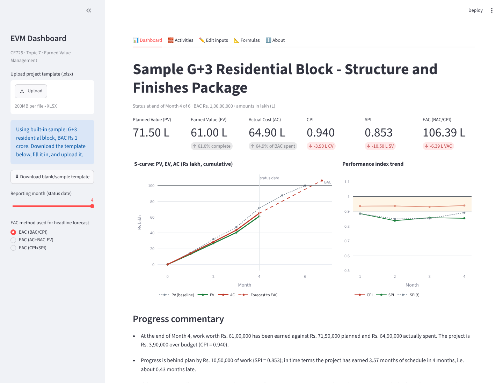
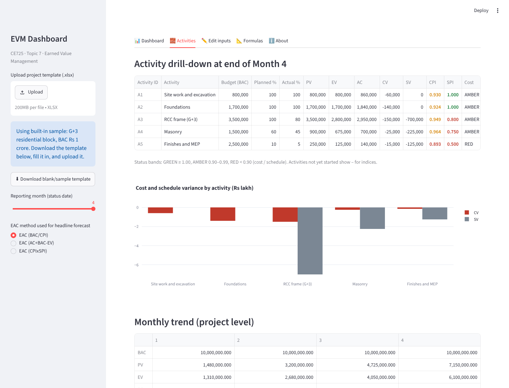
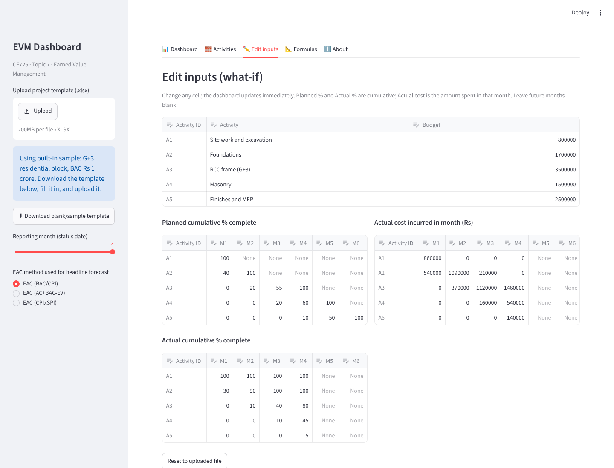
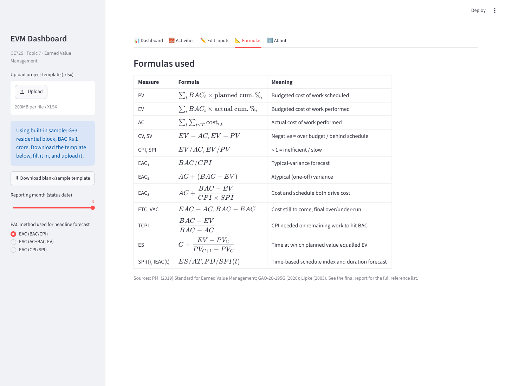

# EVM Dashboard

**Earned Value Management for construction projects** — upload monthly progress and cost, get CPI, SPI, forecasts (EAC/ETC/VAC/TCPI), Earned Schedule, activity-level RAG status and plain-language commentary.

Built for **CE725 Construction Economics and Finance, Topic 7**.

**Live app:** https://evm-dashboard-pe46patxyuxhr8cvmcnyhx.streamlit.app/
(free hosting; if it has been idle it may take ~30 s to wake up)



## Features

- **Dashboard** – PV, EV, AC, CPI, SPI, headline EAC; S-curve; CPI/SPI trend; three EAC forecasts with ETC and VAC; TCPI; Earned Schedule (ES, SV(t), SPI(t), forecast duration).
- **Reporting-month slider** – view the project as at any reported month.
- **Activities** – per-activity CV, SV, CPI, SPI with green / amber / red status bands.
- **Edit inputs** – change any planned %, actual % or cost and watch the dashboard update (what-if).
- **Excel in, Excel out** – download the template, fill it in, upload it, then download the results workbook.
- **Rule-based commentary** – generated from the computed indices (no AI model at run time), so every quoted number matches the tables.
- **Input validation** – bad or inconsistent data is flagged in the sidebar instead of crashing.

| Activities | What-if editing | Formulas |
|---|---|---|
|  |  |  |

## Run locally

```bash
python -m venv .venv && source .venv/bin/activate   # Windows: .venv\Scripts\activate
pip install -r requirements.txt
streamlit run app.py
```

Then open http://localhost:8501. The built-in sample is a G+3 residential block with BAC Rs 1 crore.

## Using your own project

1. In the sidebar, click **Download blank/sample template**.
2. Fill in the activities and budgets, planned cumulative %, actual cumulative %, and the actual cost incurred *in each month*. Leave months not yet reported blank.
3. Upload the file in the sidebar.

## Verification

Every project-level figure is checked against a hand calculation (`Benchmark_Workbook.xlsx`) at Months 2 and 4.

```bash
python -m pytest test_benchmark.py   # 30 checks against the hand benchmark
python test_edge_cases.py            # 14 edge cases (zero cost, budget exhausted, one month reported, ...)
```

Both run automatically on every push through GitHub Actions.

## Method

Formulas follow PMI (2019) *The Standard for Earned Value Management*, GAO-20-195G, and Lipke (2003) *Schedule is Different* for Earned Schedule. The full formula table is in the app's **Formulas** tab.

## Project layout

| File | Purpose |
|---|---|
| `app.py` | Streamlit dashboard (5 tabs) |
| `evm_engine.py` | Calculation engine (all formulas, validation, commentary) |
| `sample_project.xlsx` | Input template and sample project |
| `Benchmark_Workbook.xlsx` | Plain-Excel formula benchmark with hand-check columns |
| `test_benchmark.py`, `test_edge_cases.py` | Verification |
| `make_sample.py`, `make_benchmark.py` | Scripts that generated the two workbooks |
| `shots/` | Screenshots used in this README |

## Deploy your own copy

Push to a public GitHub repo, then on [share.streamlit.io](https://share.streamlit.io) choose **Create app**, pick the repo, branch `main`, main file `app.py`, and deploy.

## Limitations

Assumes % complete is reported honestly and on the same basis as the budget; Earned Schedule uses linear interpolation; no resource loading or critical-path analysis; single currency (INR).

## Changelog

**v1.1 (5 Nov 2026)** – no crash when no cost is booked (AC = 0); TCPI reported as "not defined" once actual cost reaches BAC; data date = last reported month even if a month is blank; no slider crash with only Month 1 reported; BAC caption in Indian grouping; redundant "TCPI to EAC" removed; benchmark PV for Months 5–6 now formula-derived.
